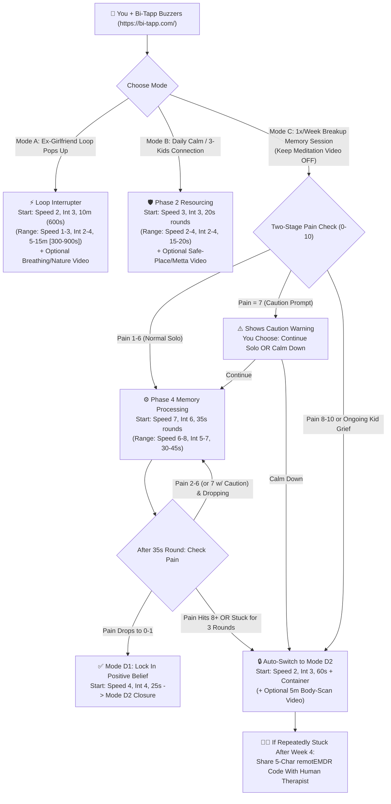

# Unified Master Plan & Clinical Guide: Bi-Tapp Tactile EMDR System (Generic Protocol Engine + Personal Treatment Companion)

* **Author**: Itay Shemesh (`itayshemesh`)
* **Repository**: `https://github.com/itayshemesh/bitapp-emdr-platform` (`main` branch)
* **Single Source of Truth**: This document unites the Plain-English Clinical Guide, Hardware & Cost Breakdown, Step-by-Step Bi-Tapp Operating Manual, Meditation & Sleep Rules, Two-Layer Software Architecture, Granular Task Roadmap, and Day-1 Setup Instructions into one coherent Master Plan.

> [!TIP]
> **In Simple Words — 30-Second Quick-Start Cheat Sheet**
> * **What to Buy**: **Bi-Tapp Base Kit ($277) + Wristbands ($20)** at `https://bi-tapp.com/` (~$309 total with US shipping).
> * **Do I Need a Phone? Yes (For the Buzzers)**: The physical Bi-Tapp buzzers only have a power button on the casing—they pair via Bluetooth to the **free Bi-Tapp app on your iPhone/Android/iPad** (no login or subscription needed) where you move the **Speed (`1–10`)** and **Intensity (`1–10`)** sliders. Our Python companion app runs locally on your computer next to your phone to coach you step-by-step.
> * **Do I Need to Register a Website? No (Zero Websites or Accounts)**: Everything runs **100% locally** on your phone and computer. You do **not** need to buy a domain, host a website, sign up for `VirtualEMDR.com`, or register on `remotEMDR.com` (even if you later hire a human therapist, only the therapist has a `remotEMDR.com` account—you just read them the 5-character code from your phone app).
> * **Weeks 1–4 Plan ($0/mo Solo First)**: Use your buzzers solo first. Only book an online human therapist in Week 5+ if a memory refuses to budge.
> * **Stop Ex-Girlfriend Thought Loops Anytime (Mode A)**: Turn on **Speed `2`, Intensity `3` for `10 mins` (`600s`)** (`Range: Speed 1–3, Int 2–4, 5–15 mins / 300–900s`) and breathe slowly (`4s` in, `6s` out) until the loop fades.
> * **Daily Calm & 3-Kids Positive Anchor (Mode B)**: Every morning/evening, picture a warm moment with your 3 kids at **Speed `3`, Intensity `3` for `20s` rounds** (`Range: Speed 2–4, Int 2–4, 15–20s`).
> * **1x/Week Breakup Memory Clearing (Mode C $\rightarrow$ D1 $\rightarrow$ D2)**: Once a week, process one breakup memory at **Speed `7`, Intensity `6` for `35s` rounds** (`Pain 1–6` normal; `Pain 7` shows a Caution Prompt; `Pain 8–10` or `3` stuck rounds **Auto-Stops** to Calming Mode **Speed `2`, Intensity `3`, `60s`**).
> * **Meditation Videos, Falling Asleep & Long Hours**:
>   - **Meditation Videos**: **YES** for slow calming modes (`Modes A, B, D2`); **NO (keep video OFF)** during fast memory rounds (`Mode C`) and belief installation (`Mode D1`).
>   - **Falling Asleep**: Use **Speed `1–2`, Intensity `1–2`** inside **loose socks** for **`20–30 mins`** with a sleep meditation or rain track (turn YouTube **Autoplay OFF**; never run fast `Mode C` before bed).
>   - **Wearing for Many Hours**: **100% safe** on low settings (`Speed 1–3, Int 1–3`), though your brain tunes out a non-stop pulse after `30–60 mins` (`15–30 min` bouts work best).

---

## 1. Overview & Your 6 Chosen Decisions

You are using the **Bi-Tapp** wireless Bluetooth tactile bilateral stimulation (BLS) kit (`https://bi-tapp.com/`) to handle two distinct emotional challenges:
1. **The 2.5-Year Breakup Loop ("Mini-Trauma")**: Unwanted, repeating thoughts (rumination) about an ex-girlfriend who left 2.5 years ago.
2. **Living Apart From Your 3 Kids**: Ongoing emotional weight, missing your 3 children, and quiet-house loneliness when not living under the same roof.

### Summary of Your 6 Governing Decisions
1. **Single Unified Document**: All clinical, operational, and software architecture docs live in this single `docs/MASTER_PLAN.md` (`docs/ARCHITECTURE_RFC.md` was removed so there is only one source of truth).
2. **Primary Treatment Strategy — Try Solo First (Human Only If Stuck)**:
   - **Weeks 1–4 (100% Solo, $0 Session Cost)**: Start completely on your own using your Bi-Tapp buzzers and this local companion app—stopping daily ex-girlfriend thought loops (`Mode A`), building warm emotional anchors around your 3 kids (`Mode B`), and running 1x/week solo EMDR sessions on manageable breakup memories (`Mode C` + `Mode D`).
   - **Weeks 5+ (Human Therapist Only If Stuck)**: Only book an online human EMDR therapist (who can remotely control your Bi-Tapp using its 5-character `remotEMDR` code) if specific memories stay stuck after 3 rounds, trigger the Level 8+ auto-stop, or if you want human support for deeper grief around living apart from your 3 kids.
3. **Two-Stage Pain Safety Gate (`0–10` Pain Scale)**:
   - **Levels `1–6` (Green — Normal Solo Mode)**: Safe to process completely on your own.
   - **Level `7` (Yellow — Caution Prompt, Your Choice)**: The app shows a clear caution warning (*"Pain level is 7/10 — proceed carefully or switch to calming mode"*) and lets **you choose** whether to continue solo or switch to calming mode.
   - **Levels `8–10` or 3 Stalled Rounds in a Row (Red — Automatic Stop)**: If pain hits `8, 9, or 10` (or fails to drop after 3 rounds in a row), the app **automatically stops** memory processing and switches your Bi-Tapp to **Calming Mode (`Speed 2, Intensity 3`)** so you never overwhelm yourself alone.
4. **Bi-Tapp Settings Format — Exact Starting Number + Comfortable Range**:
   - Every mode gives you **one exact number to start with** (so you never have to guess), plus the **comfortable adjustment range** right next to it (for example: **Start at Speed `7`, Intensity `6`, `35` seconds** | *Range: Speed `6–8`, Intensity `5–7`, `30–45` seconds*).
5. **Meditation Video, Sleep & Multi-Hour Wear Protocol**:
   - Pair meditation videos **only** with slow calming modes (`Modes A, B, D2`), and turn videos **off** during active memory rounds (`Mode C` and `Mode D1`).
   - For sleep, place the buzzers inside **loose socks** at **Speed `1–2`, Intensity `1–2`** for a `20–30 minute` wind-down (with video Autoplay OFF). Wearing them for many hours at low speed/intensity is 100% safe, though `15–30 minute` bouts prevent your brain from tuning out the pulse.
6. **Simple Two-Layer Software Split (No Unnecessary Edge-Case Over-Engineering)**:
   - **Layer 1 — Generic Framework (`framework/bls_protocol_engine/`)**: A clean, reusable 8-Phase EMDR state machine, Two-Stage Safety Circuit Breaker, hardware adapter interface, and private local session logger using standard Python 3.10+ (`0` external packages).
   - **Layer 2 — Specific Bi-Tapp Application (`apps/bitapp_personal_emdr/`)**: Your exact Bi-Tapp presets, breakup rumination target pack, 3-kids connection pack, cost/schedule calculator, and live interactive CLI coach.

---

## 2. Why a 2.5-Year Breakup Still Loops (And How It Connects to Your 3 Kids)

Normally, while you sleep (especially during dream sleep), your brain digests painful experiences and moves them from your brain's emotional alarm center (the amygdala) into long-term memory where they feel like *"old history that doesn't hurt anymore."*

### Why the Ex-Girlfriend Memory Still Loops
When a painful breakup or sudden rejection hits deeply, high stress interrupts that filing process:
* **Stuck Like an Unsaved Tab**: Moments from 2.5 years ago stay open with the original raw feelings, chest/stomach tightness, and painful thoughts (*"I was discarded"*, *"I am replaceable"*, *"I lost my chance"*).
* **Why Thinking Harder Doesn't Fix It**: Whenever you are tired or hit a quiet evening, that old alarm fires as if the breakup happened today. Your logical mind tries to "solve" the feeling by replaying the past—which creates **endless looping thoughts**.
* **How Bi-Tapp Unsticks It**: Holding or wearing the two Bi-Tapp buzzers creates an alternating left-right pulse. Doing two things at once—briefly noticing the memory while feeling the fast left-right tapping (`Speed 7`)—uses up your brain's short-term working memory, dims the sharpness of the memory, calms your body, and lets your brain finally file the breakup into the past.

### How Living Apart From Your 3 Kids Connects to the Loop
Unlike the breakup (which happened 2.5 years ago and is over), **not living with your 3 kids is an ongoing present-day reality**.
* Quiet evenings or Sunday drop-offs away from your children trigger the exact same "loss and loneliness" alarm in your brain as the breakup.
* Often, your brain jumps into replaying the ex-girlfriend like a "puzzle to solve" because that feels easier than sitting with the raw ache of missing your 3 kids.
* **How We Handle Both Safely**:
  1. **For the Ex-Girlfriend Breakup (Past Event)**: Use **Mode A** (to stop daily thought loops in `5–15 minutes`) and **Mode C** (once a week at fast tapping `Speed 7` to drain the pain out of specific breakup scenes until they drop to `0` or `1` out of `10`).
  2. **For Living Apart From Your 3 Kids (Ongoing Reality)**: When working solo, use **Mode B** (slow tapping at `Speed 3` for `20 seconds` at a time while picturing warm, proud moments with your 3 kids) to steady your nervous system. Do **not** run fast solo trauma-tapping (`Speed 7`) on raw grief about your kids without a human therapist, so you don't flood yourself with sadness while alone.

---

## 3. What to Buy, Phone vs. Computer Setup, Website FAQ & Exact Costs (`https://bi-tapp.com/`)

### 3.1 How the Bi-Tapp Buzzers, Your Phone, and Our Computer App Work Together
* **What's in the Box**: Two small, rechargeable wireless Bluetooth buzzers ("tappers", `2.5" long x 0.5" wide`) that pulse alternately—Left, Right, Left, Right.
* **Hands-Free Options**: Hold them in your palms, slip them into your pockets or loose socks, or slide them into **Wristbands** so your hands are completely free.
* **Do I Need a Phone? Yes (For the Physical Buzzers)**:
  - The physical Bi-Tapp buzzers only have a power button on the casing—they do **not** have physical speed or intensity buttons on the plastic shell.
  - To adjust **Speed (`1` to `10`)** and **Intensity (`1` to `10`)**, the buzzers pair via Bluetooth to the **free official Bi-Tapp app** on your **iPhone (iOS), Android phone, or iPad** (no login account or paid subscription required).
  - **How Your Phone and Computer Work Together**: Keep your phone next to you with the **Bi-Tapp app** open to move the Speed/Intensity sliders, while running our Python companion app (`bitapp-emdr-platform`) on your computer as your step-by-step EMDR coach, timer, safety gate, and private session logger.
* **Do I Need to Register a Website? No (Zero Websites, Zero Accounts)**:
  - **No Website or Domain to Buy**: Everything runs **100% locally** on your computer and phone—no web server or cloud database.
  - **No Paid EMDR Website Needed**: You do **not** need to sign up for `VirtualEMDR.com` or any paid subscription site.
  - **No Registration Needed on `remotEMDR.com`**: Even if you book an online human therapist in Week 5+, **you never create a `remotEMDR.com` account**. Only therapists have accounts there. You simply open the Bi-Tapp phone app $\rightarrow$ **Settings** $\rightarrow$ turn on **"Allow Provider Control"** and **"Show Provider Setup Code"**, and read that **5-character code** to your therapist on video so they can control your buzzers remotely.

### 3.2 Hardware Pricing Breakdown

| Item | Price (USD) | Recommendation & Notes |
| :--- | :--- | :--- |
| **Bi-Tapp Base Kit** | **$277.00** | **Required**: Includes 2 Bluetooth tappers, 2-in-1 USB charging cable, carrying pouch, and free iOS/Android app. |
| **Wristbands (Pair)** | **$20.00** | **Highly Recommended**: Lets you wear the tappers hands-free on your wrists during the day. |
| **Wall Charger / Extra Cable** | **$15.00** | Optional USB power adapter (`$297–$312` bundled kit range). |
| **Shipping** | **$10–$15** (US) / **$40–$60** (Intl) | Estimated **~$309 USD one-time total** (Base Kit + Wristbands + US Shipping). |

---

## 4. Comparing Solo-First vs. Online Human Options (Cost & Safety Table)

Your chosen plan is **Option 1 (Try Solo First for Weeks 1–4 at $0/month, and only use a Human Therapist if a memory stays stuck)**:

| Option | How It Works With Your Bi-Tapp | Cost (USD) | Safety & Guardrails | When to Use It |
| :--- | :--- | :--- | :--- | :--- |
| **1. [SELECTED] Try Solo First (`bitapp-emdr-platform` + Bi-Tapp App)** | You move the sliders on your Bi-Tapp phone app while our local computer coach guides you through Calming (`Modes A/B`) and Weekly Memory Processing (`Modes C/D`). | **$0 / month** (after one-time ~$309 hardware purchase) | **Two-Stage Gate**: Pain `1–6` normal; Pain `7` shows a Caution Prompt; Pain `8–10` or 3 stuck rounds **Auto-Stops** to Calming Mode. | **Weeks 1–4 Primary Plan**: Daily loop-breaking, building positive 3-kids anchors, and clearing manageable breakup memories (`1–7`). |
| **2. Commercial Self-Guided Websites (`VirtualEMDR.com`, `Easy EMDR`)** | You pay for a web dashboard with timers/worksheets, mute their screen dot, and turn on your Bi-Tapp buzzers during rounds. | **$19 – $79 / month** (`$69–$79/mo` standard) | **Low-Medium**: Static web forms that cannot tell if you are looping on the same thought. | Optional only if you want extra video tutorials, though our local app covers the 8-phase workflow for **$0/mo**. |
| **3. Online Human EMDR Therapist (Backup / Week 5+ Escalation)** | You join a video call (`60–75 min`) with an EMDRIA-certified therapist and read them your **5-character Bi-Tapp code** so they control your buzzers live via `remotEMDR.com`. | • **$0 / session** via Employer EAP / Lyra Health (`8–25` free sessions/yr)<br>• **$20–$60 copay** with insurance (`headway.co`, `helloalma.com`)<br>• **$150–$275/session** (`$600–$1,100/mo`) private pay | **Highest**: Therapist watches your reactions and uses targeted questions ("interweaves") to unstick stubborn loops. | **Weeks 5+ (Only If Stuck)**: Use if a core breakup memory hits Level `8+` Auto-Stop, stays stuck after 3 rounds, or for deep grief around your 3 kids. |
| **4. Virtual EMDR Intensive (2–3 Half-Days)** | Concentrated multi-hour video sessions over one weekend with a human specialist controlling your Bi-Tapp remotely. | **$1,500 – $3,000** package | **Highest** | Optional fast-track only if you ever want a specialist to clear deep history in a single weekend. |

---

## 5. Complete Buzzer Manual — Settings, Meditation Videos, Sleep, Long-Wear & Weekly Schedule

### 5.1 Master Settings Table (Exact Starting Number + Comfortable Range)

$$
\text{Bi-Tapp Profile}(p) = \begin{cases}
\textbf{Start: } (\text{Speed } 2, \text{Int } 3, 10\text{m } [600\text{s}]) \;\big|\; \text{Range: } (\text{Speed } 1\text{–}3, \text{Int } 2\text{–}4, 5\text{–}15\text{m } [300\text{–}900\text{s}]) & \text{Mode A: Stop Looping Thoughts} \\
\textbf{Start: } (\text{Speed } 3, \text{Int } 3, 20\text{s}) \;\big|\; \text{Range: } (\text{Speed } 2\text{–}4, \text{Int } 2\text{–}4, 15\text{–}20\text{s}) & \text{Mode B: Daily Calming & 3-Kids Anchor} \\
\textbf{Start: } (\text{Speed } 7, \text{Int } 6, 35\text{s}) \;\big|\; \text{Range: } (\text{Speed } 6\text{–}8, \text{Int } 5\text{–}7, 30\text{–}45\text{s}) & \text{Mode C: Weekly Memory Processing} \\
\textbf{Start: } (\text{Speed } 4, \text{Int } 4, 25\text{s}) \;\big|\; \text{Range: } (\text{Speed } 4\text{–}5, \text{Int } 3\text{–}4, 20\text{–}30\text{s}) & \text{Mode D1: Lock In Positive Belief} \\
\textbf{Start: } (\text{Speed } 2, \text{Int } 3, 60\text{s}) \;\big|\; \text{Range: } (\text{Speed } 1\text{–}3, \text{Int } 2\text{–}4, 60\text{–}120\text{s}) & \text{Mode D2: Session Closure & Calm}
\end{cases}
$$

| Mode | When to Use It | Exact Starting Setting | Comfortable Range | Step-by-Step Instructions (In Plain Words) |
| :--- | :--- | :--- | :--- | :--- |
| **Mode A: Stop Looping Thoughts on the Spot** | Anytime day or night when thoughts of your ex-girlfriend start spinning | **Speed `2`**<br>**Intensity `3`**<br>**`10 mins` (`600s`)** | Speed `1–3`<br>Intensity `2–4`<br>`5–15 mins` (`300–900s`) | 1. Turn on Bi-Tapp in your wristbands or pockets at **Speed 2, Intensity 3**.<br>2. Tell yourself: *"This is a 2.5-year-old memory firing, not an emergency today."*<br>3. Breathe in for `4 seconds`, out for `6 seconds` while feeling the gentle left-right pulse until the pain drops to `2` or below. |
| **Mode B: Daily Calming & 3-Kids Connection Anchor** | Every morning/evening (`10 mins`) & before any memory session | **Speed `3`**<br>**Intensity `3`**<br>**`20 sec` rounds** | Speed `2–4`<br>Intensity `2–4`<br>`15–20 sec` rounds | 1. Picture a warm, happy moment with your **3 kids** (laughing, hugging, feeling proud as their dad) or a peaceful **Safe Place**.<br>2. Notice the warm feeling in your chest.<br>3. Run **short 20-second rounds at Speed 3** *only* while the feeling stays warm and positive. Pause, breathe, and repeat `4–6` times. |
| **Mode C: Weekly Memory Processing (Phase 4)** | **Once a week** (`60–75 mins`) on a specific breakup memory (`Pain 1–6` normal; `7` caution) | **Speed `7`**<br>**Intensity `6`**<br>**`35 sec` rounds** | Speed `6–8`<br>Intensity `5–7`<br>`30–45 sec` rounds | 1. Pick **one specific snapshot** from the breakup (not the whole relationship) + the negative thought (*"I am replaceable"*) + where you feel it in your body. Rate pain (`0–10`).<br>2. Turn Bi-Tapp to **Speed 7, Intensity 6 for 35 seconds**. Just watch whatever thoughts or feelings pass by like scenery outside a train window.<br>3. **Stop the buzzers**, take a deep breath, and note: *"What is on my mind or body now?"*<br>4. Rate pain (`0–10`) and repeat 35-second rounds until pain drops to **`0` or `1`**. *(If pain stays flat for 3 rounds or hits `8+`, the app auto-stops to Mode D2).* |
| **Mode D1 & D2: Lock In Positive Belief & Close Session** | At the end of **every** Mode C session (never skip closure!) | **D1 (Belief)**: **Speed `4`, Int `4`, `25s`**<br>**D2 (Close)**: **Speed `2`, Int `3`, `60s`** | D1: Speed `4–5`, Int `3–4`, `20–30s`<br>D2: Speed `1–3`, Int `2–4`, `60–120s` | 1. **Mode D1 (When pain reaches `0–1`)**: Hold the memory together with your new positive belief (*"That chapter is over; I survived and I am moving forward"*) and run **25-second rounds at Speed 4** until the belief feels completely true (`7/7`).<br>2. **Body Scan**: Check head-to-toe for any leftover tightness and tap through it.<br>3. **Mode D2 (Always Finish Here)**: Run **60 seconds at Speed 2, Intensity 3** while picturing locking any unfinished thoughts inside a strong vault (**Container**) until next week. |

---

### 5.2 Combining Bi-Tapp With Meditation Videos (When to Use vs. When to Turn Off)

#### Why Combining Them Works So Well for Calming
1. **Stops "Meditation Backfire"**: When you have looping thoughts about an ex or miss your 3 kids, sitting quietly with a regular meditation video often backfires—as soon as you sit still, your mind jumps right back to replaying the breakup. Holding the buzzers on a slow setting (**Speed `2–3`, Intensity `3`**) gives your body a physical left-right anchor that calms your brain's alarm center from the bottom up, so your mind can actually follow the meditation.
2. **3-Sense Nervous System Reset (Touch + Sight + Sound)**: Pairing physical tactile pulses with calming visuals and guided breathing engages three senses at once, lowering stress faster than audio or video alone.
3. **Deepens the 3-Kids Connection (`Mode B`) & Session Cool-Down (`Mode D2`)**: A short Loving-Kindness (*Metta*) or Safe-Place video makes warm memories with your 3 kids feel vivid during `Mode B`, and a `5-minute` body-scan video during `Mode D2` guarantees you finish every session completely grounded.

#### Mode-by-Mode Rule for Meditation Videos

| Buzzer Mode | Combine With Meditation Video? | Why & What Video to Use |
| :--- | :---: | :--- |
| **Mode A: Stop Looping Thoughts** (`Speed 2, Int 3, 10m`) | **✅ YES (Great fit)** | Play a **visual breathing pacer (`4s` in, `6s` out)** or **calm nature video** (ocean waves / rain, no heavy talking) to break the ex-girlfriend thought loop within 2–3 minutes. |
| **Mode B: Daily Calm & 3-Kids Anchor** (`Speed 3, Int 3, 20s` rounds) | **✅ YES (Great fit)** | Use a **Safe-Place visualization** or **Loving-Kindness meditation** to picture a warm moment with your 3 kids, then let the `20s` slow tapping rounds lock that feeling in. |
| **Mode C: Weekly Memory Processing** (`Speed 7, Int 6, 35s` rounds) | **❌ NO (Turn video OFF during rounds)** | During `Mode C`, your brain must briefly focus on the painful memory while tracking the fast `Speed 7` buzzers. A voice or soothing video *during* the `35s` sets distracts your brain from accessing the memory and turns reprocessing into avoidance. |
| **Mode D1: Lock In Positive Belief** (`Speed 4, Int 4, 25s` rounds) | **❌ NO (Keep video OFF)** | Keep your focus purely on your new healthy belief (*"That chapter is over; I am building a healthy future"*) for the short `25s` rounds. |
| **Mode D2: Session Closure & Calm** (`Speed 2, Int 3, 60–120s`+) | **✅ YES (Best fit)** | Right after finishing a weekly session (or after an Automatic Stop), play a **5-minute Guided Body Scan or Breathing video** at `Speed 2, Intensity 3` to fully settle your body. |

---

### 5.3 Falling Asleep With Bi-Tapp & Wearing It for Many Hours

#### The 4 Practical Bedtime Rules (Falling Asleep With Meditation in the Background)
Bedtime is often the hardest time for breakup loops or missing your 3 kids because the house is quiet. Pairing **very slow, soft tapping** with a **background sleep meditation** bridges your brain from racing thoughts into sleep:
1. **Use Lower "Sleep Settings" (`Speed 1–2`, `Intensity 1–2`)**: Daytime calming uses `Speed 2, Intensity 3`. In a quiet bedroom, `Intensity 3` can feel too strong or buzz against the mattress. Set **Speed `1` or `2`** and **Intensity `1` or `2`** (a whisper-soft pulse).
2. **Put the Buzzers in Loose Socks (Don't Hold Them in Your Hands)**: Your fingers relax the moment you drift off, so hand-held buzzers will drop onto the bed or floor. Slip one buzzer inside **each loose, soft sock** (resting against the soft side of your foot/calf) or inside **soft sweatband wristbands**.
3. **Aim for a `20–30 Minute` Wind-Down (Turn Autoplay OFF)**: Set a `20–30 minute` sleep timer on a **Yoga Nidra / NSDR**, **Sleep Body Scan**, or **dark-screen rain track**, and turn **YouTube Autoplay OFF** so a sudden loud ad or next video doesn't wake you up at 3:00 AM.
4. **Never Run Fast Memory Work (`Mode C`) Right Before Bed**: Processing painful memories at `Speed 7` activates your brain for 1–2 hours afterward. Run your weekly `Mode C` session earlier in the day or early evening, and keep bedtime strictly for slow calming (`Speed 1–2`).

#### Does It Create an Issue If I Wear It for Many Hours at Low Speed & Intensity?
**No — it is 100% safe and causes zero harm to your brain or nervous system.** People regularly wear Bi-Tapp for hours during stressful workdays, flights, or overnight on low settings (`Speed 1–3`, `Intensity 1–3`). Just keep these **4 minor practical realities** in mind:
1. **Your Brain Tunes It Out After `30–60 Minutes` (Habituation)**: Just like your brain stops noticing the feel of a wristwatch or the hum of a fan after `30–45 minutes`, a constant unchanging pulse stops giving *extra* calming benefit after an hour. Using Bi-Tapp in **`15–30 minute` bouts** keeps your nervous system responsive. If you fall asleep with them on and wake up during the night, simply click them off.
2. **Lighter Sleep in the Early Morning Hours**: During deep sleep (first half of the night) you won't feel them at all, but in the last 2–3 hours before morning (lighter REM sleep), continuous buzzing can occasionally nudge you awake.
3. **Mild Skin Pressure Marks in Tight Socks**: If you lie on your side and a tight sock presses a buzzer against your ankle bone for 7–8 hours, it can leave a temporary red mark—always use **loose socks** and rest the buzzers against the soft part of your foot or calf.
4. **Daily Battery Charging**: On low speed and intensity, Bi-Tapp batteries last **`12–16 hours`**. If they run all night, simply plug them into the dual USB-C charger in the morning so they are ready for your daytime sessions.

---

### 5.4 Weekly Schedule & 8-Week Solo-First Timeline

* **Daily Routine (`10–15 mins/day`)**: Run **Mode B** every morning or evening to keep baseline stress low, and trigger **Mode A** on-demand (`10 mins` default; `5–15 mins` range) whenever an ex-girlfriend thought loop pops up.
* **Weekly Memory Session Limit (`Strictly 1x / week, 60–75 mins`)**:
  - **Why not every day?** After a `Mode C` session (`Speed 7`), your brain continues rewiring that memory for **48 to 72 hours** (especially during dream sleep). Doing fast memory work every day overloads your nervous system.
  - **What you will notice during the 48-hour rest window**: Vivid dreams, brief waves of emotion, or sudden moments where you realize *"I haven't thought about her all afternoon, and when I do, it feels distant and flat."*
* **Your 8-Week Solo-First Roadmap**:
  - **Week 1 (Setup & Calming Only)**: Receive your Bi-Tapp kit (`bi-tapp.com`). Practice **Mode A** (stopping thought loops) and **Mode B** (Safe Place, Container, and the 3-Kids Connection Anchor) daily. List `4 to 6` specific breakup memories rated from easiest (`Pain 4–5`) to hardest (`Pain 7–8`).
  - **Weeks 2–4 (Solo Memory Processing — $0 Session Cost)**: Once a week, run **Mode C + Mode D** on one manageable breakup memory (`Pain 4–6`, or `7` with caution). Expect each specific memory to drop to `0–1` within 1 to 2 weekly sessions.
  - **Week 5 Checkpoint (Continue Solo vs. Book Human Backup)**:
    - If your looping thoughts are dropping steadily $\implies$ continue solo through Week 8 until all breakup memories are at `0–1`.
    - If a core memory hits the **Level 8+ Auto-Stop**, stalls for 3 rounds across sessions, or centers on deep ongoing grief about living apart from your 3 kids $\implies$ book an online EMDRIA therapist (via Employer EAP/Lyra for `$0` or `emdria.org`) and share your 5-character `remotEMDR` code.

---

## 6. Interactive Workflow & Two-Stage Safety Gate Diagram



---

## 7. Two-Layer Software Architecture (Simple, Local, No Over-Engineering)

We keep the software clean, local, and practical—using only standard Python 3.10+ (`0` external libraries, no web servers, no cloud databases, and no fragile Bluetooth firmware hacks):

```mermaid
flowchart LR
    subgraph Generic["Layer 1: Generic Framework (framework/bls_protocol_engine/)"]
        Schemas["schemas.py\n(Exact Start + Range Dataclasses)"]
        Safety["safety.py\n(Two-Stage SafetyCircuitBreaker:\n1-6 Normal, 7 Caution, 8+ Auto-Stop)"]
        Engine["engine.py\n(8-Phase State Machine)"]
        Adapters["adapters.py\n(StimulationAdapter ABC)"]
        Sync["workspace_sync.py\n(Private Local JSONL Logger)"]
    end

    subgraph Specific["Layer 2: Specific Usage (apps/bitapp_personal_emdr/)"]
        Presets["bitapp_presets.py\n(Bi-Tapp Presets + Ranges + remotEMDR)"]
        Packs["clinical_packs.py\n(2.5yr Breakup Pack & 3-Kids RDI Pack)"]
        Analyzer["options_analyzer.py\n(Solo-First Cost, Schedule & Sleep Guide)"]
        CLI["cli.py\n(Interactive Command-Line Coach)"]
    end

    Specific --> Generic
```



### Repository Layout

```
bitapp-emdr-platform/
├── README.md
├── pyproject.toml
├── .gitignore
├── docs/
│   └── MASTER_PLAN.md
├── framework/
│   └── bls_protocol_engine/
│       ├── __init__.py
│       ├── schemas.py
│       ├── safety.py
│       ├── engine.py
│       ├── adapters.py
│       └── workspace_sync.py
├── apps/
│   └── bitapp_personal_emdr/
│       ├── __init__.py
│       ├── bitapp_presets.py
│       ├── clinical_packs.py
│       ├── options_analyzer.py
│       └── cli.py
└── tests/
    ├── test_framework_engine.py
    └── test_bitapp_personal_app.py
```

### Component Responsibilities (In Simple Words)

1. **Layer 1 — Generic Framework (`framework/bls_protocol_engine/`)**:
   - `schemas.py`: Simple `@dataclass` records for the 8 EMDR phases, hardware settings (Exact Starting Number + Comfortable Range), target memories, and session results.
   - `safety.py`: `SafetyCircuitBreaker` enforcing the Two-Stage Safety Gate (`Pain 1–6` normal, `Pain 7` caution prompt with your choice, `Pain 8–10` or `3` stalled rounds automatic stop to calming mode).
   - `engine.py`: `ProtocolEngine` that steps through Phases 1 to 8 in order and guarantees every session finishes with calming closure (`Phase 7`).
   - `adapters.py`: `BiTappCompanionAdapter` that prints the exact Speed/Intensity slider numbers for your phone app (plus `AudioVisualSimulatedAdapter` for automated tests).
   - `workspace_sync.py`: Saves your private session summaries to `~/.local/share/bitapp-emdr/sessions/sessions.jsonl` (`chmod 700`) strictly outside the Git repository.
2. **Layer 2 — Specific Bi-Tapp Application (`apps/bitapp_personal_emdr/`)**:
   - `bitapp_presets.py`: Exact starting numbers + comfortable ranges for Modes A (`600s` start, `300–900s` range), B (`20s` start, `15–20s` range), C (`35s` start, `30–45s` range), D1 (`25s` start, `20–30s` range), D2 (`60s` start, `60–120s` range), and the 5-character `remotEMDR` therapist bridge.
   - `clinical_packs.py`: Pre-built target packs for your **2.5-Year Breakup Loop** and **3-Children Fatherhood Connection Anchor**.
   - `options_analyzer.py`: Cost, weekly schedule, meditation video pairing, sleep setup, and Solo-First roadmap reference.
   - `cli.py`: Interactive command-line coach supporting `--mode=interactive` (live step-by-step guided solo session), `--mode=loop-interrupt` (on-demand 10-minute loop breaker), `--mode=summary` (full settings, cost & sleep cheat sheet), and `--mode=simulate-session` (automated demo walkthrough).

---

## 8. Implementation Roadmap & Granular Tasks

| Step | Task ID | Layer | Deliverable Summary | Target Files |
| :--- | :--- | :--- | :--- | :--- |
| **Phase 1** | `TASK-101` | Documentation | Author unified Master Plan & Clinical Guide (`docs/MASTER_PLAN.md`) including Meditation Video, Bedtime Sleep, and Long-Wear rules as single source of truth. | `docs/MASTER_PLAN.md` |
| **Phase 2** | `TASK-102` | Security & Setup | Scaffold package metadata, documentation index, and strict `.gitignore` secret isolation (`~/.config/bitapp-emdr/oauth_client.json`). | `README.md`, `pyproject.toml`, `.gitignore` |
| **Phase 3** | `TASK-103` | Generic Framework | Implement domain-agnostic `@dataclass` schemas (Exact Start + Comfortable Range) and Two-Stage `SafetyCircuitBreaker` (Warning at 7, Auto-Stop at 8). | `framework/bls_protocol_engine/__init__.py`, `framework/bls_protocol_engine/schemas.py`, `framework/bls_protocol_engine/safety.py` |
| **Phase 4** | `TASK-104` | Generic Framework | Implement 8-phase `ProtocolEngine` state machine, `BiTappCompanionAdapter`, and `GoogleWorkspaceSessionExporter`. | `framework/bls_protocol_engine/engine.py`, `framework/bls_protocol_engine/adapters.py`, `framework/bls_protocol_engine/workspace_sync.py` |
| **Phase 5** | `TASK-105` | Specific App | Implement Bi-Tapp presets, 2.5-year breakup & 3-kids clinical packs, Solo-First cost/schedule/meditation/sleep analyzer, and CLI runner (`summary`, `loop-interrupt`, `interactive`, `simulate-session`). | `apps/bitapp_personal_emdr/__init__.py`, `apps/bitapp_personal_emdr/bitapp_presets.py`, `apps/bitapp_personal_emdr/clinical_packs.py`, `apps/bitapp_personal_emdr/options_analyzer.py`, `apps/bitapp_personal_emdr/cli.py` |
| **Phase 6** | `TASK-106` | Verification | Implement unit and integration test suites verifying all 8 phases, Two-Stage Safety Gate, interactive CLI coach, meditation/sleep report, and all 5 Bi-Tapp presets. | `tests/test_framework_engine.py`, `tests/test_bitapp_personal_app.py` |
| **Phase 7** | `TASK-107` | Security Gate | Execute pre-push confidentiality and secret scan verifying zero leaked credentials or internal links. | `docs/MASTER_PLAN.md`, `.gitignore` |
| **Phase 8** | `TASK-108` | GitHub Rollout | Push feature branch, open Pull Request, and sync `main` on `https://github.com/itayshemesh/bitapp-emdr-platform`. | `README.md`, `docs/MASTER_PLAN.md` |

---

## 9. Concrete Day-1 Setup, Rollout Strategy & How to Run

### Step 1: Physical Bi-Tapp + Phone Setup (Zero Websites or Accounts Needed)
1. **No Website Registration**: Do **not** register any domain, website, or subscription (`VirtualEMDR.com` is not needed, and you do not need a `remotEMDR.com` account).
2. **Pair Your Buzzers to Your Phone**:
   - Install the free official **Bi-Tapp** app from the Apple App Store (iOS) or Google Play Store (Android) — no account creation required.
   - Turn on Bluetooth on your phone, press the physical button on both Bi-Tapp tappers until the LED lights flash, and tap **Pair / Connect** inside the Bi-Tapp phone app.
   - Keep the Bi-Tapp phone app open next to your computer so you can adjust the **Speed (`1–10`)** and **Intensity (`1–10`)** sliders whenever our Python coach tells you to.

### Step 2: Clone & Run the Python Companion App on Your Computer
Everything runs on standard **Python 3.10+** with **zero external `pip` packages required**.

```bash
# Clone your repository and enter the folder:
git clone https://github.com/itayshemesh/bitapp-emdr-platform.git
cd bitapp-emdr-platform

# 1. LIVE INTERACTIVE COACH (Use this for your real weekly 60-75 min solo EMDR sessions):
#    Walks you step-by-step through picking a memory, setting your phone sliders,
#    timing each 35s round, and checking your 0-10 pain/belief numbers with the Two-Stage Safety Gate:
PYTHONPATH=. python3 -m apps.bitapp_personal_emdr.cli --mode=interactive

# 2. ON-DEMAND RUMINATION INTERRUPTER (Use anytime thoughts of your ex start looping):
#    Displays the immediate 3-step guide (Speed 2, Intensity 3, 10 minutes + optional breathing/meditation video tip):
PYTHONPATH=. python3 -m apps.bitapp_personal_emdr.cli --mode=loop-interrupt

# 3. FULL CHEAT SHEET, MEDITATION/SLEEP GUIDE & COST SUMMARY:
PYTHONPATH=. python3 -m apps.bitapp_personal_emdr.cli --mode=summary

# 4. AUTOMATED DEMO SESSION (Runs a simulated 8-phase session end-to-end and saves a sample log):
PYTHONPATH=. python3 -m apps.bitapp_personal_emdr.cli --mode=simulate-session

# 5. RUN AUTOMATED TESTS (Verifies Two-Stage Safety Gate, presets, interactive mode, and logs):
PYTHONPATH=. python3 -m unittest discover -s tests -p "test_*.py" -v
```

### GitHub Pull Request Rollout & Secret Isolation
1. **Single Source of Truth on GitHub**: All updates are verified by unit tests and `pre_push_checker.py`, pushed to a feature branch, and submitted via Pull Request to `main` at `https://github.com/itayshemesh/bitapp-emdr-platform`.
2. **Zero Credential Check-In**: Your local session logs are saved privately to `~/.local/share/bitapp-emdr/sessions/` on your computer (and if you ever configure optional local OAuth metadata, it lives at `~/.config/bitapp-emdr/oauth_client.json` (`chmod 600`) strictly outside the Git repository).
